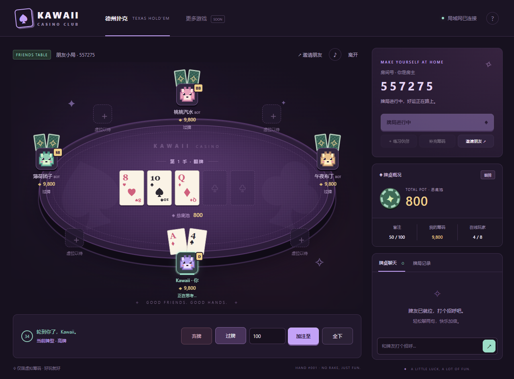

# ♠ Kawaii Casino

**今晚，来一手。** 和朋友在同一 Wi-Fi 下围坐一张紫色像素牌桌。

游戏厅现有 **无限注德州扑克（Texas Hold’em）**、**21点（Blackjack）**、**斗地主（Dou Dizhu）**、**麻将（简化四川麻将）** 和 **掼蛋（Guandan）**，支持电脑与手机浏览器。建房时选择游戏，每个房间独立开玩。纯虚拟筹码，无注册、支付或兑换功能。

| 游戏     | 玩家席位             | 单人练习                          |
| -------- | -------------------- | --------------------------------- |
| 德州扑克 | 2–8 人               | 可添加最多 3 位练习伙伴           |
| 21点     | 1–5 人（庄家不占席） | 自动庄家，可添加最多 4 位练习伙伴 |
| 斗地主   | 恰好 3 人            | 可添加两位练习伙伴                |
| 麻将     | 恰好 4 人            | 可添加三位练习伙伴                |
| 掼蛋     | 恰好 4 人（两队）    | 可添加三位练习伙伴                |



## 快速开始

安装 [Node.js 22 或更高版本](https://nodejs.org/)。Windows 用户可以直接双击 **`start-casino.cmd`**，首次运行会安装依赖。

也可以在终端运行：

```sh
git clone https://github.com/XiangyuHuHu/KawaiiCasino.git
cd KawaiiCasino
npm ci
npm start
```

1. 房主打开 **http://localhost:3000**，输入昵称、选择游戏和像素头像并创建房间。
2. 点击「邀请朋友」，把**局域网地址和六位房间号**发给朋友。
3. 朋友连接同一个 Wi-Fi，用浏览器打开邀请链接，输入昵称即可入座；也可以手动输入房间号。
4. 房主点击「开始发牌」：德州扑克至少两位有筹码的在线玩家；21点一人即可开始，先逐座下注再发牌；斗地主恰好三位、麻将和掼蛋恰好四位在线玩家且每人至少 10 筹码。每手结束后点击「再来一手」。

一个人也能点击「练习伙伴」添加机器人，服务器稍作停顿后自动行动。德州扑克使用简单策略，21点伙伴会按点数及庄家明牌选择要牌、停牌、加倍和分牌，斗地主伙伴按大牌和炸弹数量叫分，优先出较长的低点数组合，通常不压农民队友；麻将伙伴选择张数最少的花色定缺，保留对子和相邻牌，有胡则胡、有杠则杠，抢牌立即决定；掼蛋伙伴优先出较长低点数组合、保留炸弹，通常不压搭档，能出完则优先出完；只用于练习，不代表专业策略。

## 局域网连接

服务监听 `0.0.0.0:3000`，终端会打印本机所有 IPv4 地址。选择实际连接 Wi-Fi/以太网的地址，例如 `http://192.168.1.10:3000`；不要选 VPN 或虚拟网卡地址。朋友设备上的 `localhost` 指向朋友自己的设备，应使用房主的局域网地址。

如果打不开：

- 保持主机终端运行，确认两台设备在同一局域网。
- 在 Windows 防火墙提示中允许 **Node.js 访问专用网络**。
- 检查路由器是否启用了访客 Wi-Fi 或 AP/客户端隔离。
- 不需要公网 IP，也不需要路由器端口转发。

端口占用时，可以改端口：

```powershell
$env:PORT = '3001'
npm start
```

macOS / Linux：`PORT=3001 npm start`。

## 掼蛋规则

- **恰好 4 人，固定两队，无庄家。** 座位从引擎的 0 开始，0/2 对 1/3；界面显示一至四号座，即 1/3 座对 2/4 座。离桌者本手保留并自动行动，结束后空位补入者继承该座位与队伍，其他玩家不换队。双副标准扑克牌（各含两王），共 **108 张，每人 27 张**，每张实物牌有独立 id。开局每人至少 **10 筹码**，不足复用「补充筹码」；练习伙伴不自动补码，余额不足可重建练习房间。
- 两队各从 **2 级**开始；首手打 2，之后打上手获胜队伍的当前级别。普通点数为 **2 < 3 < … < K < A < 级牌 < 小王 < 大王**（将级牌从原位置提到 A 上方）。同点不同花色不比大小。**红桃级牌是逢人配**，两张均可替代任意非王牌，包括级牌及不同花色；可用于配对、三张、三带二、连续牌、炸弹和同花顺，不能替王。
- 支持 **单张、对子、三张、三带二（不同点数的三张加一对）、顺子（恰好 5 张）、三连对（恰好 3 对）、钢板（恰好 2 组连续三张）、炸弹（4–8 张同点数）、同花顺（5 张）、天王炸（两张小王加两张大王）**。两张同色王可成对，也可作为三带二的对子；大小王混对无效。没有三带一、四带二或带翅膀钢板，超过 8 张同点数不能一起出。
- 连续牌按**原牌面点数**，级牌仍能参与且不被移到末尾，不含王；A 可在首或尾，不能循环。顺子允许 A2345（按 5 比较）至 10JQKA（按 A 比较），三连对允许 AA2233 至 QQKKAA，钢板允许 AAA222 至 KKKAAA。同花顺只要求配牌后的五张同花同顺；逢人配可变为所需花色。
- 普通应牌须同型同张数，比主体点数；三带二只比三张，不比较对子。**4 张炸 < 5 张炸 < 同花顺 < 6 张炸 < 7 张炸 < 8 张炸 < 天王炸**，炸弹内部张数优先，同张数再比提升后的点数；同花顺比顺子最大点数。普通顺子不能压同花顺。服务器自动识别所选牌：优先最高炸弹类别，再取较高主体；普通牌歧义先比主体，同值按内部类型名排序。应牌时在能合法压过上手的解释中选最高一种，无需手工指定配牌。
- 首手一号座先出，之后由上手第一名先出。按座位顺时针，跳过已出完者；自由领出必须出牌。其余仍有牌者均不出后，上次出牌者自由领出；若其已出完，由仍有牌的搭档**接风**，搭档也出完则由该出牌者顺时针下个有牌者领出。出完不会立即清除上手，其他人仍可压牌。第三位出完时剩余玩家记为第四名；本实现双下也继续打至第三人出完，以给出完整名次。
- 第一名所属队伍获胜：队伍包揽 **第一/二名（双下）升 3 级**，第一/三名升 **2 级**，第一/四名升 **1 级**。仅赢家队伍升级，败队保留级别。**无进贡/还贡**；标准整场需在 A 级真正获胜，本实现**级别封顶 A，A 级获胜也继续下一手，不宣布整场终局**，不设其他地区升级或贡牌规则。
- 每手结束结算，**底分 10 × 本手升级数**为每位输家的应付总额，两位赢家均分实际收款；例如双下满额时两位输家各付 30，两位赢家各得 30（不是每个赢家再收一份 30）。**每位输家独立按余额封顶，赢家仅分实收，不透支、不向庄家结算。** 若双下两位输家只有 3 和 100，实际支付 3 和 30，赢家分别得 17 与 16；奇数余筹给固定座位靠前的赢家。整数筹码总额严格守恒，只有显式补码增加总额；结算前不预扣。
- 点击选中手牌再按「出牌」，或「帮我一步」使用服务器机器人策略。显示本手级牌、双方级别、余牌、最后出牌、当前行动者、名次和净结算。包括搭档在内的其他手牌整手隐藏，结算后公开剩余牌。每步默认 **35 秒**，超时可不出则不出，自由领出则出提升排序后的最小单张；离线/离桌同样使用安全动作。机器人共用可配置延迟，一位真人可加三位练习伙伴完整开玩。

## 麻将规则 · 简化四川麻将

- **恰好 4 人，单局到第一位胡牌即结束**，不使用血战到底。使用 **108 张万 / 条 / 筒（各 1–9，每种四张）**，没有字牌或花牌。每手重新洗全副牌，庄家 14 张、其他人 13 张、牌墙 55 张。第一手一号座坐庄，之后**赢家坐庄，流局由原庄家下家坐庄**；预定庄家离桌则由清理后的首位保留座位接任。四席必须在线、每人至少有底分 **10** 才能开局，不足请在手牌结束后「补充筹码」。练习伙伴不自动补码，余额不足可重新建房练习。
- **先定缺**：从庄家起按座位选择缺万 / 缺条 / 缺筒，每人选一次，选择公开。机器人和定缺超时选择手中张数最少的一门；相同时按万、条、筒顺序选择。定缺完成后庄家先打牌，其后按座位顺时针摸一张、打一张。**手里有缺门牌时必须先打缺门牌；仍持有缺门牌不能胡，不能碰或杠缺门牌。** 其他两门仍可碰杠，碰杠后同样先打缺门。
- **不吃牌**。可碰同种弃牌（手内有两张）、明杠同种弃牌（手内有三张）、暗杠手内四张同种牌，或在自己的摸牌回合把第四张加入已有的碰（加杠）。碰后不摸牌，直接打牌，也不能立即暗杠/加杠或自摸胡；须等下次摸牌。**每次杠后从牌墙尾补一张**，普通摸牌从墙头取；可连续杠后补牌。没有补牌时不能杠。
- 胡牌为 **四组顺子/刻子加一对将**（每副杠算一组），或无副露的 **七对**。顺子必须同门连续三张、不循环；七对中同种四张可当两对，但没有龙七对额外番。可以自摸或点炮胡。对手暗手与暗杠牌面在手内隐藏，手牌结束时全部公开；点炮胡的最后一张独立显示，仍留在牌河中，不复制进赢家手牌。
- **胡 > 杠/碰**；多人可胡同一张弃牌时，从出牌者下家起按座位顺序处理，第一位接受胡牌者获胜（**截胡，不一炮多响**）。先逐个处理胡牌窗口，全部过后再逐个处理碰杠窗口；同一位玩家过胡后若仍可碰杠，会获得第二个窗口。碰与杠同级，也按出牌者下家起的顺序。真人每个窗口最长 **8 秒**（测试配置可更短），超时「过」；机器人轮到其抢牌窗口立即决定，不等待普通机器人延迟。只有轮到自己的窗口才显示对应的「胡 / 碰 / 杠 / 过」按钮。
- **平胡 = 1 倍**。为避免“基础一番”与翻倍指数混淆，程序把平胡的加番起点记为 **0**，每份 = **底分 10 × 2^加番数**，累计加番最多 **3**，即 **8 倍、每份最多 80**。对对胡 **+1**、清一色 **+2**、七对 **+2**、赢家副露中每个实际杠（明/加/暗）**+1**、杠后补的这张自摸胡（杠上开花）**+1**；满足的项目累加，封顶前番数也保留。没有宣告成杠的四张不加杠番；对对胡须能全部按刻子/杠解释。
- **自摸：其余三家各付一份，再各加底分 10（自摸加底，不再翻倍）**。例如平胡每家付 20、封顶时每家付 90。**点炮：只有出牌者付一份，不加底**。不预扣筹码，不设庄家账本，所有收付只在本手结束结算。
- **输家付款按自身余额独立封顶，赢家只收实际支付的筹码**，不能透支或凭空补足名义奖金。例如自摸每家应付 20，三家余额 5、11、100，则实际付 5、11、20，赢家只收 36；点炮应付 80、出牌者剩 7，则只转移 7。所有余额为整数且非负，每一步及结算后玩家筹码总和严格不变；只有显式补码增加筹码。
- 牌墙最后一张摸出后仍可胡或打牌；最后弃牌仍允许点炮胡，不能再碰杠。无人胡时**流局，所有玩家净收付为 0**。不查叫、不查花猪，不计流局罚款。
- 明确简化：**不换三张、不抢杠胡、不血战、不一炮多响，不计杠的即时支付（刮风下雨）**；也不计根、金钩钓、天胡/地胡、海底或杠上炮等未列出的额外番，不限制过胡后再胡，不设听牌声明。只有杠后补牌立即自摸算杠上开花，打出后不延续该加番。
- 点选一张麻将再按「出牌」；暗杠/加杠也先选择要杠的同种牌中任意一张，再按对应按钮；也可用「帮我一步」按机器人策略行动一次。普通行动 **35 秒**；超时出最小合法牌（万、条、筒及点数顺序，有缺先缺），定缺超时选最少门，抢牌超时过。离桌保留本手座位，按上述默认动作完成并结算，结束后移除；断线也按计时默认动作继续，四席开局后没有中途入局。

## 斗地主规则

- **恰好 3 人，地主对两位农民，无庄家。** 使用单副 54 张牌（含小王、大王），每人 17 张，另留 3 张底牌。开局每人至少 10 筹码，不足需在手牌结束后使用「补充筹码」补至建房时的初始额度。
- 第一手随机首叫，之后每手首叫座位轮转；全不叫重发时首叫也轮转。每位玩家只能叫分一次，可不叫（0），或叫高于当前分数的 **1 / 2 / 3 分**。3 分立即结束叫分，否则三人叫完取最高分者为地主。全不叫时重新洗完整副牌，**最多重发 3 次**；第四轮仍全不叫，强制本轮首叫者为 1 分地主。
- 地主拿走底牌变为 20 张，底牌公开给所有人，地主先出。其他玩家手牌只显示余牌数，直到手牌结算才公开剩余牌。大小为 **3 < 4 < … < 10 < J < Q < K < A < 2 < 小王 < 大王**，花色不参与比较。
- 支持 **单张、对子、三张、三带一、三带一对、顺子、连对、飞机、四带二、炸弹、王炸**。顺子至少 5 张；连对至少 3 对；飞机至少 2 组连续三张。顺子、连对和飞机主体均不含 2 或王，A 不循环接 3。
- 飞机可不带翅膀，也可每组三张带一张单牌或一对。翅膀不得与主体同点数；**单翅膀可重复点数，对翅膀必须是不同点数的对子**。四带二可带两张单牌（允许是一对），或带两个不同点数的对子。四张不能拆成三张主体再把同点第四张当翅膀。若同一批牌能解释为多种飞机，应牌时采用能合法压过上手的解释；自由领出优先不带翅膀的飞机，再按较低主体解释。
- 普通牌须**同牌型、同张数与同主体长度**，只比较主体最大点数，翅膀大小无关。炸弹压普通牌，炸弹之间比点数；王炸压其他所有牌，不能被压。连续两人不出后，上次出牌者自由领出；自由领出不可不出。任一玩家出完，所属阵营立即获胜。
- **每份分值 = 底分 10 × 地主叫分 × 2^(炸弹次数 + 王炸次数) × 春天倍数**。每次实际打出炸弹或王炸各翻倍；地主胜且两位农民均未出过牌为「春天」，农民胜且地主仅出过一次牌为「反春」，各再翻倍。四带二、拆开的四张或当翅膀使用均不算炸弹。
- 地主胜，两位农民各付一份；农民胜，地主向两位农民各付一份。**所有输家最多付出当前余额，不得透支；赢家只获得实际付出的筹码**。地主胜时各农民独立封顶；农民胜且地主不足两份时，将地主实际可付余额均分，奇数余筹给座位顺序靠前的农民。例如每份 10、地主剩 15，则地主付 15，两位农民分别得 8 与 7。结算前不预扣筹码，手内及结算时玩家余额总和严格守恒，只有显式补码增加总额。
- 点击手牌选中，再按「出牌」，或按「帮我一步」由服务器按练习伙伴策略行动一次。每步 **35 秒**，叫分超时不叫，应牌超时不出，自由领出超时打最小单张。练习伙伴延迟与其他游戏相同，可由服务器配置。
- 简化规则：**不设额外加倍、抢地主、明牌、癞子或地区变体**；不设农民互相结算。离桌或断线仍保留本手座位，按上述超时安全动作完成并正常结算，离桌者在本手结束后移除。三席开局后没有中途入局。练习伙伴不会自动补码，筹码不足时可重新建房练习。

## 21点规则

- **庄家是自动运行的牌桌，不需要机器人席位。** 每位玩家分别与庄家比较，不互相争抢底池。每人初始筹码与德州扑克相同，手牌结束后可使用「补充筹码」补至初始额度。
- 使用 **6 副牌（312 张）**，每手开始时剩余不足 25% 就重新洗牌。极端长牌局若耗尽牌鞋，只洗入之前各手的弃牌，当前手牌保留。
- 先按座位依次下注，最低 **10**，最高为手头全部筹码，只接受整数。不足 10 的玩家等待补码。下注全部完成后分两圈发牌：每圈玩家依座位各拿一张，庄家最后拿一张；庄家第二张牌隐藏。庄家发牌后检查黑杰克。
- A 计为 1 或 11，J/Q/K 为 10。首两张 A 加 10 点牌为黑杰克；分牌后的 21 点按普通手牌计算。庄家 **软 17 停牌（S17）**，不足 17 自动要牌。
- 玩家可**要牌、停牌**；首两张且余额足够时可**加倍**，再付一份下注，只补一张便停牌。达到 21 自动停牌，超过 21 立即判输。
- 相同 **rank（牌面，如两张 Q；10 与 Q 不算相同）** 可再付一份注**分牌一次**，拆成两手后各补一张。禁止再次分牌；分 A 后每手只拿一张并停牌。其他分牌允许首两张加倍。
- 普通获胜净赢 **1:1**，黑杰克净赢 **3:2，向下取整**，平局退回下注，爆牌或落败不返还。例：下注 11，黑杰克返还 27（本金 11 + 净赢 16）；普通赢返还 22；平局返还 11。双方黑杰克为平局；庄家黑杰克击败其他所有非黑杰克手牌。
- **不设保险或投降。** 每次操作限时 35 秒，行动超时自动停牌，下注超时自动下最低注。离桌时未下注不扣款，已下注手牌自动停牌并正常结算；中途加入从下一手参与。
- 界面按每手显示下注、返还和净盈亏；余额随结算更新。下注立即记入庄家，返还从庄家扣除，**玩家余额之和 + 庄家累计净盈亏** 在每局内保持不变。庄家净盈亏可为负数，不代表玩家可以透支；只有显式补码会增加总筹码。

## 德州扑克与通用功能

- 六位房间号、邀请链接、多房间隔离，最多 8 位玩家。
- 紫色牌桌、8 款原创 SVG 像素头像、手机布局、可选回合提示音。
- 小盲/大盲、庄位轮转、翻牌前/翻牌/转牌/河牌四轮下注。
- 过牌、跟注、加注、弃牌、全下；输入的加注额为**本轮总下注额**。
- 最佳五张牌比较、A2345 顺子、踢脚比较、边池、平局分池、奇数筹码及未跟注筹码退回。
- 服务端洗牌和裁决；对手底牌只在符合资格的摊牌时公开，弃牌底牌保持隐藏。
- 每次行动 35 秒；超时有欠注则弃牌，否则过牌。
- 原浏览器标签页刷新/重连恢复座位；房主断线自动转移给其他在线真人。
- 中途入座从下一手开始；离桌时在应行动时自动弃牌，已全下的玩家保留底池资格。
- 牌桌聊天、手牌历史、手牌结束后补充虚拟筹码、机器人练习。

## 保存与使用范围

房间、聊天和筹码只保存在服务进程内存中，**服务重启会清空**。没有在线真人的房间会在闲置六小时后清理。原座位凭证保存在当前标签页的 `sessionStorage` 中；关闭标签页后不保证恢复。断线玩家会保留座位；德州与21点在下一手暂停入局，斗地主需三位、麻将和掼蛋需四位在线且筹码足够才可再次开局。

这是面向可信局域网朋友的初版。房间号相当于入场口令，服务器主机是可信裁判；尚未加入账号、长期存档、观战、锦标赛、房主踢人或公网服务防护。

客户端和样式资源由本机服务提供，安装完依赖后游戏无需访问 CDN。

## 开发和验证

```sh
npm run dev            # 服务代码变更自动重启（房间会重置）
npm run check          # JavaScript 语法检查
npm test               # 德州、21点、斗地主、麻将、掼蛋规则、随机筹码守恒与真实 Socket.IO 联机测试
npx playwright install chromium
npm run test:browser   # 德州、21点、斗地主、麻将及掼蛋整手对局、刷新恢复与手机布局
```

如果已经安装 Microsoft Edge，可以跳过浏览器下载，运行：

```powershell
$env:PLAYWRIGHT_CHANNEL = 'msedge'
npm run test:browser
```

浏览器测试独立运行在 3100 端口。

## 项目结构

```text
public/                  浏览器界面、样式、SVG 像素头像
server/poker.js          保留原有 API 的德州扑克规则与结算引擎
server/games/index.js    游戏注册表与中文名称、席位、机器人能力元数据
server/games/poker.js    德州扑克通用接口适配器
server/games/blackjack.js 21点规则、六副牌鞋与庄家账本
server/games/doudizhu.js 斗地主牌型、叫分、机器人与零和结算
server/games/mahjong.js  简化四川麻将定缺、胡牌、碰杠、机器人与零和结算
server/games/guandan.js  掼蛋双副牌、逢人配、固定队伍、级别与零和结算
public/games/           各游戏独立的桌面渲染模块
server/index.js          HTTP 与 Socket.IO 房间服务
test/poker.test.js       德州扑克规则与随机牌局筹码守恒检查
test/blackjack.test.js   21点固定牌序、合法行动、赔付及千局随机总账检查
test/doudizhu.test.js    斗地主牌型、叫分、封顶结算与500局随机整手检查
test/mahjong.test.js     麻将胡牌、番数、截胡、补牌、封顶与500局随机整手检查
test/guandan.test.js     掼蛋牌型、逢人配、接风、升级、封顶与250局随机整手检查
test/network.test.js     多客户端联机测试
test/browser/            Playwright 浏览器端到端测试
start-casino.cmd         Windows 启动入口
```

技术栈：Node.js、Socket.IO、原生 HTML/CSS/JavaScript，无需前端构建。

### 扩展游戏引擎

在 `server/games/<name>.js` 实现引擎，并在 `server/games/index.js` 的 `games` 中注册 `Engine`、`name`、`minPlayers`、`maxPlayers`、`bots`。大厅通过 `/api/games` 获取列表，房间状态携带 `gameType` 与 `game` 元数据。德州扑克仍默认使用 `poker`，21点使用 `blackjack`，斗地主使用 `doudizhu`，麻将使用 `mahjong`，掼蛋使用 `guandan`。

通用接口：`players`（整数余额 `stack`）、`buyIn`、`playing`、`stage`、`hand`、`version`、`turn`、`deadline`，以及 `addPlayer`、`prune`、`start`、`action(id, payload)`、`legal(id)`、`automaticAction(id, isBot)`、`remove`、`log` 和 `view(id)`。`view` 只返回可公开状态，凭证和未公开的牌留在服务器。引擎负责校验动作与金额、推进轮次及结算。

Socket.IO 的 `create` 支持 `{ name, gameType, stack, ... }`，省略游戏保持原德州扑克行为。`deal` / `start` / `next` 都由房主开始下一手；`action` 统一传 `{ type, amount?, hand, version }`，旧版扑克动作继续有效，21点动作是 `bet`、`hit`、`stand`、`double`、`split`；斗地主动作是 `bid`（`amount: 0/1/2/3`）、`play`（`cards: [手牌 id, ...]`）、`pass`、`assist`（帮我一步）。麻将动作是 `void`（`suit: "wan"/"tiao"/"tong"`）、`discard`（`tile: 手牌 id`）、`hu`、`pong`、`kong`、`concealedKong` / `addedKong`（`tile: 要杠的手牌 id`）、`pass`、`assist`；`legal` 返回可出牌 id 和合法杠选项。掼蛋动作是 `play`（`cards: [手牌 id, ...]`）、`pass`、`assist`；两副相同牌面有不同 id，不能重复提交同一张。`bots`、`rebuy`、聊天、加入、恢复与离开共用房间流程。新增游戏桌面在浏览器渲染表中注册，并把静态模块加入服务器 `files` 映射，保留现有 CSP。

测试可用 `createCasino({ botDelay: 0, tickInterval: 5, actionTimeout: 35000 })` 配置机器人延迟、轮询间隔和各游戏行动时限；实际运行默认机器人延迟 1 秒、轮询 300 毫秒、行动 35 秒。未传入这两项时，分别读取环境变量 `BOT_DELAY_MS` 与 `ACTION_TIMEOUT_MS`（非负整数；空值或非法值回退默认，`0` 表示机器人在下一轮询立即行动）。显式参数优先于环境变量。实现只使用 ES2023 及更早的语言特性，可在本地 Node 20 检查；项目推荐与声明版本仍为 Node >=22。
